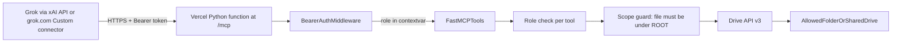
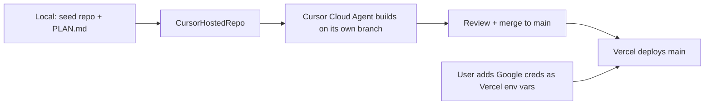

# Scoped Google Drive MCP for Grok

## Architecture

Access is limited at two levels:

1. **Google:** the Google identity the server uses can only see the allowed folder or Shared Drive.
2. **The server:** every tool call checks the caller's role and confirms the file is inside the allowed folder before calling Drive.

## Execution flow

- A Cloud Agent needs a remote repo. I seed `~/Projects/scoped-drive-mcp` locally, commit this plan as `docs/PLAN.md`, and push it to a new Cursor-hosted repo (GitHub works too if you prefer).
- The Cloud Agent works only against a fake Drive client and never sees your Google credentials or Vercel token.
- After merge, deploy happens through the connected Vercel integration or the `vercel` CLI. You enter the Google secrets yourself in Vercel's environment-variable settings.

## Vercel hosting changes

- **Entry point:** `api/index.py` exposes an ASGI `app` (the auth middleware wrapping `mcp.streamable_http_app()`), and `vercel.json` rewrites `/mcp` to it. Local `uvicorn` still works for development.
- **Serverless-friendly MCP:** `FastMCP(..., stateless_http=True, json_response=True)`, so each request is self-contained with no sessions or long-lived SSE streams.
- **Secrets as env vars:** `GOOGLE_CREDENTIALS_B64` (service-account JSON, or the OAuth client plus refresh token for `oauth_bot`), `ROOT_FOLDER_ID`, `SHARED_DRIVE_ID`, `API_TOKENS`. No credential files on disk.
- **Logging and caching:**
  - The audit log goes to stdout as JSON lines, which shows up in Vercel logs. There's no local file.
  - The subfolder cache lives in memory per instance with a short lifetime, so a cold start rebuilds it.
- **Limits:** keep `MAX_BYTES` small enough to finish within the function time limit. Set `maxDuration` in `vercel.json`.
- Remove the `uvicorn`-only and ngrok assumptions from the README and verification steps.

## Key design decisions

- **Which Google identity the server uses (set by `AUTH_MODE`):**
  - `service_account`: use with a **Shared Drive** (needs Google Workspace). Add the service account as a Content manager. Writes need a Shared Drive because service accounts have no storage quota of their own, so uploads into a My Drive folder fail.
  - `oauth_bot`: use a dedicated bot Gmail account with a stored refresh token, and share the target folder with it as Editor. Works on personal Gmail, and new files count against the bot account's storage.
- **OAuth scope:** full `https://www.googleapis.com/auth/drive`. `drive.file` can't see shared folders. The actual limit comes from what's shared with the bot plus the scope guard.
- **Roles, mapped to tools:**
  - `viewer`: `search_files`, `list_folder`, `get_metadata`, `read_file`
  - `editor`: everything `viewer` has, plus `create_folder`, `create_doc`, `upload_file`, `update_file_content`, `rename_file`
  - `admin`: everything `editor` has, plus `trash_file`
  - No role gets move, share, permission-change or permanent-delete tools.
- **Scope guard:**
  - Shared Drive mode: check that the file's `driveId` matches the configured drive, then walk up its parent folders to `ROOT_FOLDER_ID` if one is set.
  - Folder mode: walk the `parents` chain with a short-lived cache. Refuse to trash the root folder itself. For any create, the target parent folder must be inside the root.
- **Search:**
  - Shared Drive mode: `corpora=drive&driveId=...`.
  - Folder mode: list all subfolders (cached), build a query of the form `('id1' in parents or ...)` split into chunks, and run the scope guard again on every result.
- **Tokens:** set in `API_TOKENS` as SHA-256 hash and role pairs, compared with a timing-safe check. The role is passed to tools through a `contextvars.ContextVar`.
- **Output limits and logging:**
  - Google Docs, Sheets and Slides are exported as text or CSV.
  - Downloads are capped at `MAX_BYTES` and text output at `MAX_CHARS`.
  - Every call is written to stdout as a JSON audit line with token ID, tool name, file ID, decision and timestamp.

## Project layout (`~/Projects/scoped-drive-mcp`)

- [pyproject.toml](~/Projects/scoped-drive-mcp/pyproject.toml): uv; dependencies `mcp`, `google-api-python-client`, `google-auth`, `google-auth-oauthlib`, `pydantic-settings`, `uvicorn`; dev dependency `pytest`
- [src/scoped_drive_mcp/config.py](~/Projects/scoped-drive-mcp/src/scoped_drive_mcp/config.py): settings loaded from environment variables (`AUTH_MODE`, `ROOT_FOLDER_ID`, `SHARED_DRIVE_ID`, credentials path, `API_TOKENS`, limits)
- [src/scoped_drive_mcp/drive_client.py](~/Projects/scoped-drive-mcp/src/scoped_drive_mcp/drive_client.py): builds the credentials and a thin Drive wrapper with `supportsAllDrives=True`
- [src/scoped_drive_mcp/scope.py](~/Projects/scoped-drive-mcp/src/scoped_drive_mcp/scope.py): `assert_in_scope(file_id)`, `assert_parent_in_scope`, subfolder listing and cache
- [src/scoped_drive_mcp/policy.py](~/Projects/scoped-drive-mcp/src/scoped_drive_mcp/policy.py): the role-to-tool map and a `require(tool)` decorator
- [src/scoped_drive_mcp/auth.py](~/Projects/scoped-drive-mcp/src/scoped_drive_mcp/auth.py): Starlette middleware that checks the bearer token and sets the role context
- [src/scoped_drive_mcp/server.py](~/Projects/scoped-drive-mcp/src/scoped_drive_mcp/server.py): `FastMCP("scoped-drive")` with the tools, `stateless_http=True`, `json_response=True`; `build_app()` wraps `mcp.streamable_http_app()` with the auth middleware
- [api/index.py](~/Projects/scoped-drive-mcp/api/index.py) and [vercel.json](~/Projects/scoped-drive-mcp/vercel.json): Vercel entry point (`app = build_app()`), the `/mcp` rewrite and `maxDuration`
- [requirements.txt](~/Projects/scoped-drive-mcp/requirements.txt): runtime dependencies exported for Vercel's Python builder
- [scripts/bootstrap_oauth.py](~/Projects/scoped-drive-mcp/scripts/bootstrap_oauth.py): one-time sign-in flow that saves the bot account's refresh token (`oauth_bot` mode)
- [tests/](~/Projects/scoped-drive-mcp/tests/): a fake Drive client; tests for scope-guard escapes (outside file, file reached through a moved parent, root-trash attempt), the role matrix and token rejection
- [README.md](~/Projects/scoped-drive-mcp/README.md): Google Cloud setup, sharing steps, connecting from Grok

## Connecting Grok

- **xAI API:** add `{"type":"mcp","server_url":"https://<project>.vercel.app/mcp","server_label":"drive","authorization":"<token>","allowed_tools":[...]}` to the tools list in `POST /v1/responses`.
- **grok.com:** go to Connectors, click New Connector, then Custom. Open question to check: whether the Custom connector form accepts a static bearer token. If it only supports OAuth, add a minimal OAuth layer later. That isn't needed for the API route.
- In both cases, disconnect Grok's built-in Google Drive connector so Grok can't bypass this server.

## Verification

- The Cloud Agent runs `pytest` for the scope and role tests, plus a local `uvicorn` smoke test of `/mcp` (rejects requests without a token, lists tools with a valid one).
- Use MCP Inspector against `https://<project>.vercel.app/mcp` with tokens for each role.
- Do a live check against the Vercel URL with an xAI Responses API call:
  - Ask for a file inside the folder: it should succeed.
  - Ask for a file outside the folder by its ID: it should return a forbidden error.
  - Use a viewer token to attempt a write: it should be denied.