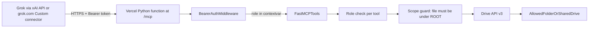
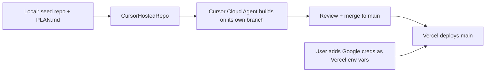
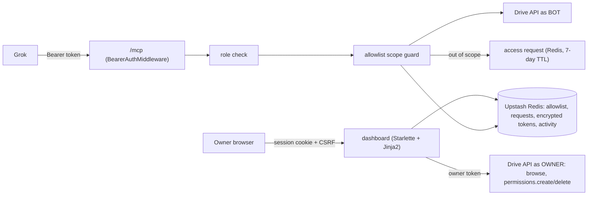

# Scoped Google Drive MCP for Grok

## Architecture

Access is limited at two levels:

1. **Google:** the Google identity the server uses can only see the allowed folder or Shared Drive.
2. **The server:** every tool call checks the caller's role and confirms the file is inside the allowed folder before calling Drive.

## Execution flow (phase 1)

- A Cloud Agent needs a remote repo. I seed `~/Projects/scoped-drive-mcp` locally, commit this plan as `docs/PLAN.md`, and push it to a new Cursor-hosted repo (GitHub works too if you prefer).
- The Cloud Agent works only against a fake Drive client and never sees your Google credentials or Vercel token.
- After merge, deploy happens through the connected Vercel integration or the `vercel` CLI. You enter the Google secrets yourself in Vercel's environment-variable settings.

## Vercel hosting changes

- **Entry point:** `api/index.py` exposes an ASGI `app` (the auth middleware wrapping `mcp.streamable_http_app()`), and `vercel.json` rewrites `/mcp` to it. Local `uvicorn` still works for development.
- **Serverless-friendly MCP:** `FastMCP(..., stateless_http=True, json_response=True)`, so each request is self-contained with no sessions or long-lived SSE streams.
- **Secrets as env vars:** `GOOGLE_CREDENTIALS_B64` (service-account JSON, or the OAuth client plus refresh token for `oauth_bot`), `ROOT_FOLDER_ID`, `SHARED_DRIVE_ID`, `API_TOKENS`. No credential files on disk.
- **Logging and caching:**
  - The audit log goes to stdout as JSON lines, which shows up in Vercel logs. There's no local file.
  - The subfolder cache lives in memory per instance with a short lifetime, so a cold start rebuilds it.
- **Limits:** keep `MAX_BYTES` small enough to finish within the function time limit. Set `maxDuration` in `vercel.json`.
- Remove the `uvicorn`-only and ngrok assumptions from the README and verification steps.

## Key design decisions

- **Which Google identity the server uses (set by `AUTH_MODE`):**
  - `service_account`: use with a **Shared Drive** (needs Google Workspace). Add the service account as a Content manager. Writes need a Shared Drive because service accounts have no storage quota of their own, so uploads into a My Drive folder fail.
  - `oauth_bot`: use a dedicated bot Gmail account with a stored refresh token, and share the target folder with it as Editor. Works on personal Gmail, and new files count against the bot account's storage.
- **OAuth scope:** full `https://www.googleapis.com/auth/drive`. `drive.file` can't see shared folders. The actual limit comes from what's shared with the bot plus the scope guard.
- **Roles, mapped to tools:**
  - `viewer`: `search_files`, `list_folder`, `get_metadata`, `read_file`
  - `editor`: everything `viewer` has, plus `create_folder`, `create_doc`, `upload_file`, `update_file_content`, `rename_file`
  - `admin`: everything `editor` has, plus `trash_file`
  - No role gets move, share, permission-change or permanent-delete tools.
- **Scope guard:**
  - Shared Drive mode: check that the file's `driveId` matches the configured drive, then walk up its parent folders to `ROOT_FOLDER_ID` if one is set.
  - Folder mode: walk the `parents` chain with a short-lived cache. Refuse to trash the root folder itself. For any create, the target parent folder must be inside the root.
- **Search:**
  - Shared Drive mode: `corpora=drive&driveId=...`.
  - Folder mode: list all subfolders (cached), build a query of the form `('id1' in parents or ...)` split into chunks, and run the scope guard again on every result.
- **Tokens:** set in `API_TOKENS` as SHA-256 hash and role pairs, compared with a timing-safe check. The role is passed to tools through a `contextvars.ContextVar`.
- **Output limits and logging:**
  - Google Docs, Sheets and Slides are exported as text or CSV.
  - Downloads are capped at `MAX_BYTES` and text output at `MAX_CHARS`.
  - Every call is written to stdout as a JSON audit line with token ID, tool name, file ID, decision and timestamp.

## Project layout (`~/Projects/scoped-drive-mcp`)

- [pyproject.toml](~/Projects/scoped-drive-mcp/pyproject.toml): uv; dependencies `mcp`, `google-api-python-client`, `google-auth`, `google-auth-oauthlib`, `pydantic-settings`, `uvicorn`; dev dependency `pytest`
- [src/scoped_drive_mcp/config.py](~/Projects/scoped-drive-mcp/src/scoped_drive_mcp/config.py): settings loaded from environment variables (`AUTH_MODE`, `ROOT_FOLDER_ID`, `SHARED_DRIVE_ID`, credentials path, `API_TOKENS`, limits)
- [src/scoped_drive_mcp/drive_client.py](~/Projects/scoped-drive-mcp/src/scoped_drive_mcp/drive_client.py): builds the credentials and a thin Drive wrapper with `supportsAllDrives=True`
- [src/scoped_drive_mcp/scope.py](~/Projects/scoped-drive-mcp/src/scoped_drive_mcp/scope.py): `assert_in_scope(file_id)`, `assert_parent_in_scope`, subfolder listing and cache
- [src/scoped_drive_mcp/policy.py](~/Projects/scoped-drive-mcp/src/scoped_drive_mcp/policy.py): the role-to-tool map and a `require(tool)` decorator
- [src/scoped_drive_mcp/auth.py](~/Projects/scoped-drive-mcp/src/scoped_drive_mcp/auth.py): Starlette middleware that checks the bearer token and sets the role context
- [src/scoped_drive_mcp/server.py](~/Projects/scoped-drive-mcp/src/scoped_drive_mcp/server.py): `FastMCP("scoped-drive")` with the tools, `stateless_http=True`, `json_response=True`; `build_app()` wraps `mcp.streamable_http_app()` with the auth middleware
- [api/index.py](~/Projects/scoped-drive-mcp/api/index.py) and [vercel.json](~/Projects/scoped-drive-mcp/vercel.json): Vercel entry point (`app = build_app()`), the `/mcp` rewrite and `maxDuration`
- [requirements.txt](~/Projects/scoped-drive-mcp/requirements.txt): runtime dependencies exported for Vercel's Python builder
- [scripts/bootstrap_oauth.py](~/Projects/scoped-drive-mcp/scripts/bootstrap_oauth.py): one-time sign-in flow that saves the bot account's refresh token (`oauth_bot` mode)
- [tests/](~/Projects/scoped-drive-mcp/tests/): a fake Drive client; tests for scope-guard escapes (outside file, file reached through a moved parent, root-trash attempt), the role matrix and token rejection
- [README.md](~/Projects/scoped-drive-mcp/README.md): Google Cloud setup, sharing steps, connecting from Grok

## Connecting Grok

- **xAI API:** add `{"type":"mcp","server_url":"https://<project>.vercel.app/mcp","server_label":"drive","authorization":"<token>","allowed_tools":[...]}` to the tools list in `POST /v1/responses`.
- **grok.com:** go to Connectors, click New Connector, then Custom. Open question to check: whether the Custom connector form accepts a static bearer token. If it only supports OAuth, add a minimal OAuth layer later. That isn't needed for the API route.
- In both cases, disconnect Grok's built-in Google Drive connector so Grok can't bypass this server.

## Verification

- The Cloud Agent runs `pytest` for the scope and role tests, plus a local `uvicorn` smoke test of `/mcp` (rejects requests without a token, lists tools with a valid one).
- Use MCP Inspector against `https://<project>.vercel.app/mcp` with tokens for each role.
- Do a live check against the Vercel URL with an xAI Responses API call:
  - Ask for a file inside the folder: it should succeed.
  - Ask for a file outside the folder by its ID: it should return a forbidden error.
  - Use a viewer token to attempt a write: it should be denied.
---

## Phase 2: Drive picker dashboard, allowlist and access requests

Status: implemented on branch `cursor/phase-2-drive-picker-3e39`. Deployment, Upstash provisioning and secrets are
done by the coordinator.

### Goal

The owner opens a web page, signs in with their own Google account, browses their whole My Drive and ticks the
folders and files Grok may use. Grok reaches only ticked items (and the contents of ticked folders). Anything
else returns an `access_required` error with an approval link; the owner approves or denies it, and can untick
(revoke) at any time.

### Enforcement: bot share + server allowlist (both layers)

- **Grant:** with the owner's token, `permissions.create(type=user, emailAddress=BOT_EMAIL, role=writer,
  sendNotificationEmail=false)`; store `{id, name, mime_type, permission_id, granted_at, request_id}` in the
  Redis hash `sdm:allowlist`. Granting a shortcut grants its target.
- **Revoke:** remove the allowlist entry first, then `permissions.delete(permission_id)` (a 404 is ignored; any
  other failure is shown to the owner with instructions).
- **Scope rule:** in scope if the id is allowlisted, or walking up `parents` with the bot's credentials reaches
  an allowlisted id. Missing/invisible parents stop the walk (out of scope). Cycle, depth and lookup caps and
  the ancestor cache (`SCOPE_CACHE_TTL`) are unchanged. `ROOT_FOLDER_ID` is optional and, if set, an extra
  allowlisted folder.
- **Multi-parent rule:** in scope if ANY parent chain reaches an allowlisted id. The bot only sees the file if
  the owner shared it, so this does not widen what Google allows.
- **Freshness:** the allowlist is re-read at most every `ALLOWLIST_CACHE_TTL` seconds (default 2, max 10), and
  invalidated immediately on the instance that performed a grant/revoke.
- **Protected items:** allowlisted items cannot be renamed or trashed; a directly granted file may still have its
  content updated by an editor token.
- **Search:** fixed-template queries over all folders under allowlisted folders, plus one unrestricted query whose
  results are accepted only if their id is an individually allowlisted file. Every result is re-checked.
- **list_folder()** with no id lists the allowlisted items.
- **Creates without parent_id** go to `ROOT_FOLDER_ID`, else the only allowlisted folder, else are refused.

### Access requests

- Created only on scope denials (`OutOfScopeError`), never on role denials or malformed input. Stored as
  `sdm:req:<id>` (JSON, 7-day TTL), deduped through `sdm:req:pending:<file_id>`, indexed in `sdm:requests:index`.
- Ids are `secrets.token_urlsafe(24)` (192 bits). Records hold file_id, file name (only if the bot can see it),
  description, tool, token_name, reason, created_at, status, decided_at, granted_id/name.
- The tool result is `CallToolResult(isError=True)` with `structuredContent = {error: "access_required",
  request_id, approval_url, file_id, message}` (and the same JSON as text). The file name is not returned to Grok.
- Viewer tools `request_access(description, reason, file_id?)` and `check_access_request(request_id)`.
- `/requests/<id>` (owner only): details, Approve with "just this item" or "its parent folder" (not My Drive's
  root), or Deny. Description-only requests link to `/browse?request=<id>` to pick any item.

### Dashboard and auth

- Pages: `/`, `/browse?folder=&q=`, `/access`, `/requests`, `/requests/<id>`, `/activity`, `/connect-bot`,
  `/login`, `/auth/login`, `/auth/callback`, `POST /logout`, `POST /grant`, `POST /revoke`,
  `POST /requests/<id>/approve|deny`, `POST /bot/disconnect`. Server-rendered Jinja2, inline CSS, no JS.
- One Google OAuth client of type Web application; redirect URI `APP_BASE_URL/auth/callback`; scopes
  `openid email drive`, `access_type=offline`, `prompt=consent`. The flow (`owner` or `bot`) and a nonce travel
  in an itsdangerous-signed `state` (10 minutes); the nonce is also in the session and is single-use.
- The account is checked through the userinfo endpoint (`email_verified` required). Owner flow requires
  OWNER_EMAIL; bot flow requires an owner session and BOT_EMAIL. Wrong accounts are rejected and their token is
  revoked. The Drive scope must be granted.
- Refresh tokens are Fernet-encrypted (ENCRYPTION_KEY) in Redis. The bot token from `/connect-bot` is used when
  GOOGLE_OAUTH_REFRESH_TOKEN is not set (`LazyBotDriveClient`, re-read every 30 s).
- Session: Starlette `SessionMiddleware` (signed, httponly, Secure unless APP_BASE_URL is http://localhost,
  SameSite=Lax, 8 h). CSRF token per session on every POST, plus a same-origin `Origin` check. CSP, frame and
  referrer headers on every dashboard response. Referrer-Policy is `same-origin`: `no-referrer` would make
  browsers send `Origin: null` on form posts (including logout) and fail that check.
- Separation: `/mcp` is its own ASGI app behind `BearerAuthMiddleware`; the dashboard is mounted separately and
  never reads the Authorization header. Neither accepts the other's credential.
- Activity: every audit line goes to stdout and to the capped Redis list `sdm:activity` (500).

### Settings

Required (reported by `/health` when missing): `API_TOKENS` (hard requirement), `GOOGLE_OAUTH_CLIENT_ID`,
`GOOGLE_OAUTH_CLIENT_SECRET`, `OWNER_EMAIL`, `APP_BASE_URL`, `SESSION_SECRET`, `ENCRYPTION_KEY`,
`UPSTASH_REDIS_REST_URL`/`UPSTASH_REDIS_REST_TOKEN` (or `KV_REST_API_URL`/`KV_REST_API_TOKEN`).
Optional: `BOT_EMAIL` (recommended, see below), `GOOGLE_OAUTH_REFRESH_TOKEN`, `ROOT_FOLDER_ID`, `AUTH_MODE`,
`MAX_BYTES`, `MAX_CHARS`, `SCOPE_CACHE_TTL`, `ALLOWLIST_CACHE_TTL`. Without Redis an in-memory store is used for
local development and tests; when `VERCEL` is set and Redis is missing, the app serves only `/health` (503,
`store_error: redis_not_configured`) and setup errors for `/mcp` and the dashboard.
`/health` reports `mode`, missing names, `store`, `owner_connected`, `bot_connected` and `bot_source`, never values.

### Follow-ups (same PR)

- **Same-account mode:** if `BOT_EMAIL` is unset or equals `OWNER_EMAIL` (case-insensitive), the tools use the
  owner's stored refresh token (`GOOGLE_OAUTH_REFRESH_TOKEN` still wins), grant/revoke/approve only change the
  allowlist (no permission calls), `/connect-bot` is not needed and refuses bot flows. The allowlist and scope
  guard are the only boundary. The overview, access and bot pages show a warning recommending a separate bot.
  The owner's My Drive root can't be granted in either mode.
- **Switching to a bot:** allowlist entries record `shared_with` (the bot address their `permission_id` belongs
  to). `POST /access/share-bot` (CSRF, bot connected) runs `permissions.create` for every entry not yet shared
  with the current bot, stores the new ids, removes a share left for an earlier bot address (best effort), and
  reports failures; running it again does nothing.
- **Parents in tool output** are filtered to ids that are allowlisted or inside an allowlisted item
  (`ScopeGuard.parent_in_scope`, memoised per call); the key is dropped when nothing remains.
- **`GET`/`DELETE /mcp`** return 405 with `Allow: POST` before a session manager is created (a GET with
  `Accept: text/event-stream` used to hang until the platform timeout).
- **Tests** generate keys and tokens at runtime; the phase-1 scope/service/policy/app suites run in both modes
  (owner view; bot view that only sees what is shared with it).

### Phase-1 risks re-checked

- **Shortcuts:** no code path reads `shortcutDetails.targetId`; shortcuts can't be listed or used as parents;
  tests assert the target is never fetched or downloaded.
- **Parents:** `check_update_metadata` allows only `name`/`trashed`; `check_create_metadata` requires exactly one
  parent and no other keys; `addParents`/`removeParents` are never sent. Enforced in the Google client, the lazy
  bot client and the fake Drive.
- **Also fixed:** `ToolError` raised inside a tool is no longer turned into a generic failure; blank env values
  (as in `.env.example`) count as unset.

### Verification

- `pytest` (no network): fake Drive with owner and bot views, in-memory store, fake OAuth. Covers grant/revoke,
  nested scope, revocation timing, access_required shape and dedupe, approve/deny, the two request tools, owner
  and bot sign-in restrictions, CSRF, credential separation, shortcuts and parents.
- Local uvicorn smoke test: logged-out pages redirect to `/login`, `/mcp` rejects missing tokens and the
  dashboard cookie, and initialize/tools/list/tools/call work with a token.
- Live (coordinator): the README walkthrough steps 1-7.
